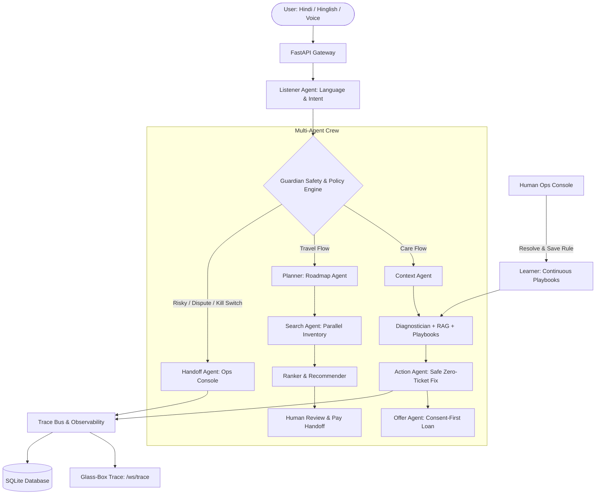

# Saarthi: Multi-Agent AI Teammate for Bharat
**Paytm AI Hackathon (Track 3: Autonomous AI Teammates)**

> *"A chatbot answers questions. A teammate closes the loop."*

Saarthi is an autonomous, multi-agent AI teammate designed for Indian merchants and consumers:
1. **Saarthi Care (Merchant Side):** On-demand check-ups (the merchant taps "Check my settlement", chats, speaks, or presses the Soundbox button), zero-ticket resolution, Soundbox diagnostics and consent-first loan offers. Nothing runs until the user asks. Hero: *Ramesh*, Kirana owner in Delhi.
2. **Saarthi Travel (Consumer Side):** Multi-agent concierge that builds visible roadmaps, searches flights in parallel, applies transparent scoring, and hands over to the human to review and pay. Hero: *Arjun* & *Meena Aunty*.

---

## Architecture



---

## Non-Negotiable Safety Rules (Enforced in Code)
- **R1: Strict Number Grounding:** All financial figures (amounts, fees, dates, prices, EMI) come strictly from deterministic tools. Response text is validated; responses with ungrounded numbers are rejected.
- **R2: Pre-Execution Guardian:** Every proposed agent action is inspected by the Guardian before execution.
- **R3: Human-in-the-Loop Financials:** Payments, loan approvals, and refunds are human-only. The travel concierge ends at a pre-filled Review & Pay link; the agent never confirms payments or enters PINs.
- **R4: Complete Traceability:** Every step is written to `agent_runs` and `audit_log`, and streamed over WebSocket.
- **R5: Instant Kill Switch:** Global kill switch pauses autonomous mutations and downgrades actions to human escalation.
- **R6: Consent-First Offers:** At most ONE loan offer per interaction, only after resolution, and stops immediately if declined.
- **R7: Zero PIN/OTP Tolerance:** Saarthi never requests or accepts PINs, passwords, or OTPs.

---

## Quickstart (Under 10 Commands)

```bash
# 1. Clone & Enter directory
cd saarthi

# 2. Create virtual environment
python -m venv .venv

# 3. Activate virtual environment
# Windows:
.venv\Scripts\activate
# Linux/macOS:
source .venv/bin/activate

# 4. Install dependencies
pip install -r requirements.txt

# 5. Seed database (Merchants, 121 Indian airports, Kaggle flights, policies)
python scripts/seed.py --reset

# 6. Run test suite (offline)
pytest -v

# 7. Run evaluation suite (offline, temp DB)
python eval/run_eval.py

# 8. Start development server
uvicorn app.main:app --reload --port 8000
```

---

## Running Offline vs Real Providers

- **Offline Mode (Default, Zero Config):**
  Runs 100% locally with `DEMO_MODE=true` in `.env`. Uses `MockLLM` with scripted deterministic scenarios, local `edge-tts` Hindi neural voice, seeded SQLite flight inventories, and local BM25 RAG. No external accounts or paid API keys needed.
- **Live Provider Mode:**
  Set `DEMO_MODE=false` in `.env` and add:
  - `GEMINI_API_KEY`: Enables live Google Gemini 1.5 Flash reasoning.
  - `SARVAM_API_KEY`: Enables live Sarvam AI Indic STT.

Check active adapter status anytime at:
```bash
curl http://localhost:8000/health/adapters
```

---

## API (v1)

All business endpoints live under `/api/v1` and require a Bearer token (demo tokens via
`POST /api/v1/auth/demo-token` when `DEMO_MODE=true`). See `scripts/curl_examples.md` for one call per
demo beat and `/docs` (OpenAPI) for the full list. Key on-demand endpoints:

| Method | Endpoint | Trigger |
| :--- | :--- | :--- |
| `POST` | `/api/v1/checkups` | "Check my settlement / device / payments / refunds / all" button |
| `POST` | `/api/v1/issues` | "Raise an issue" (check-up first; ticket only if unresolved or insisted) |
| `POST` | `/api/v1/soundbox/{device_id}/ask` | Soundbox button or voice command; returns audio_url |
| `POST` | `/api/v1/chat` | Chat message (Hindi / Hinglish / English) |
| `POST` | `/api/v1/voice/turn` | Voice note → reply with audio_url |
| `GET` | `/api/v1/pulse/{merchant_id}`, `/api/v1/advice/{merchant_id}` | Morning pulse / festival & battery advice, on request |
| `GET` | `/api/v1/travel/status/{booking_ref}` | Traveller asks for booking status |
| `POST` | `/api/v1/demo/scenario/{name}` → `/api/v1/demo/trigger/{name}` | Demo: set up data, then simulate the user's tap |
| `GET` | `/api/v1/metrics` | Business metrics (ops/admin), computed from the DB |
| `WS` | `/ws/trace`, `/ws/merchant/{id}`, `/ws/console` | Events sent only in response to user triggers |
